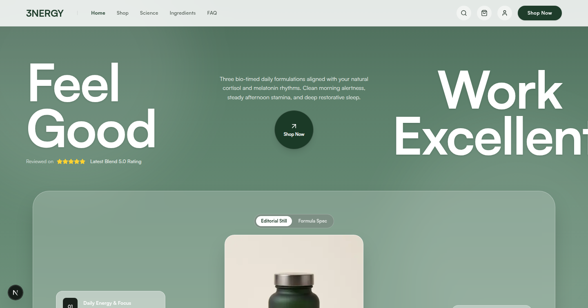
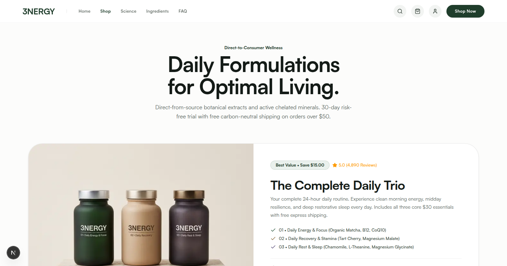
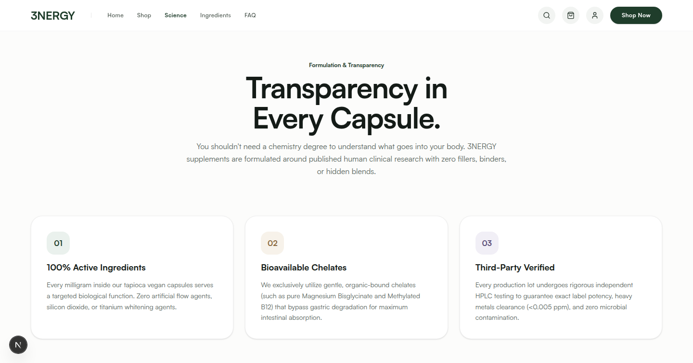

# 3NERGY

A premium e-commerce concept project built for a fictitious clean supplement brand, focusing on minimal aesthetics, high-performance web architecture, and seamless user experiences. This project serves as a portfolio piece demonstrating advanced frontend capabilities.

## Overview

3NERGY is designed around the core philosophy of clean, science-backed wellness without unnecessary extras. The interface reflects this ideology with a clean, high-contrast, nature-inspired palette (Forest Green, Sage, Sand, Lavender) and an edge-to-edge full-bleed layout.

## Screenshots

### Home Page


### Shop Page


### Science Page


## Technical Architecture

* **Framework:** Next.js (App Router)
* **Library:** React 19
* **Styling:** Tailwind CSS v4
* **Language:** TypeScript
* **Typography:** Satoshi (Custom optimized local font)

## Key Features

* **Zero-Gap Viewport Architecture:** Custom global layout configuration that completely eliminates cross-browser scrollbar gutters to achieve true edge-to-edge full bleed designs across all devices and operating systems.
* **Responsive Interactions:** Slide-over cart drawer and interactive modal systems tailored for fluid mobile and desktop interactions.
* **Component-Driven Design:** Highly reusable, modular architecture for product cards, trust ribbons, and dynamic navigation.
* **Performance Focused:** Built using Next.js Turbopack for rapid development cycles and optimized static payload generation.

## Getting Started

To run this project locally, clone the repository and install the dependencies:

```bash
# Clone the repository
git clone https://github.com/Jack-Pision/3nergy.git

# Navigate into the project directory
cd 3nergy

# Install dependencies
npm install

# Start the development server
npm run dev
```

Open `http://localhost:3000` in your browser to view the application.

## Author

Designed and built by Jack Pision. 
* GitHub: [github.com/Jack-Pision](https://github.com/Jack-Pision)
* X: [x.com/Jack_pision](https://x.com/Jack_pision)

This is a concept project created for portfolio demonstration purposes. All branding and product information is fictitious.
